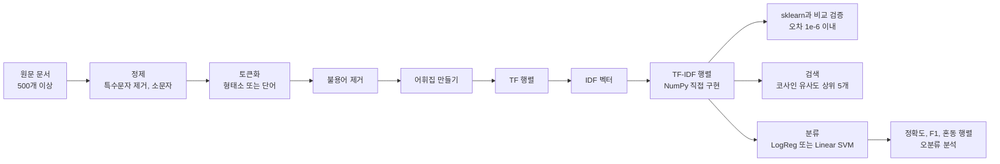
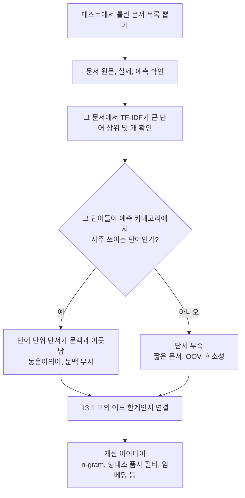

# A4-1 개념 정리 — 토큰화, TF-IDF, 코사인 유사도로 만드는 문서 검색·분류기

대상: Python은 써 봤지만 자연어 처리(NLP)는 처음인 학습자<br>
기준 과제: [A4-1 과제 명세](../subject.md)<br>
함께 보는 문서: [단계별 실습 가이드](WALKTHROUGH.md)

이 문서는 정답 코드를 주는 문서가 아닙니다. **과제를 직접 구현하려면 무엇을 알아야 하는지**를 차례대로 설명합니다. 개념마다 일상 비유로 감을 잡고, 정확한 정의와 수식을 본 다음, 작은 숫자 예제를 손으로 계산해 보고, 마지막으로 과제의 어느 요구사항과 연결되는지 확인합니다.

과제의 핵심 질문은 "**단어의 출현 빈도만으로 문서의 의미를 파악할 수 있는가?**"입니다. 이 문서를 다 읽으면 이 질문에 "어디까지는 된다, 어디부터는 안 된다"를 근거와 함께 답할 수 있어야 합니다.

## 읽는 순서

| 순서 | 배울 내용 | 이걸 알면 할 수 있는 일 |
| --- | --- | --- |
| 1 | 전체 그림: 텍스트를 숫자로 바꾸는 이유 | 과제 전체 파이프라인을 그림으로 설명하기 |
| 2 | 말뭉치, 문서, 토큰, 어휘집 | 과제 문서에 나오는 용어를 정확히 읽기 |
| 3 | 텍스트 정제 | 특수문자 제거 범위와 소문자 변환 기준 정하기 |
| 4 | 토큰화 (영어와 한국어의 차이) | 언어에 맞는 토큰화 방법 고르고 근거 쓰기 |
| 5 | 불용어와 동의어 처리 | 불용어 목록 설계하고 근거를 리포트에 쓰기 |
| 6 | Bag of Words와 문서-단어 행렬 | 문서 집합을 NumPy 행렬로 표현하기 |
| 7 | NumPy 핵심 도구 | 반복문 대신 행렬 연산으로 계산하기 |
| 8 | TF, IDF, TF-IDF, L2 정규화 | TF-IDF 행렬을 직접 계산하기 |
| 9 | scikit-learn `TfidfVectorizer`와의 대응 | 오차 1e-6 이내 검증 로그 만들기 |
| 10 | 벡터, 내적, 노름, 코사인 유사도 | 쿼리와 가장 비슷한 문서 5개 찾기 |
| 11 | 지도 학습 분류와 데이터 분할 | TF-IDF 특성으로 분류 모델 학습하기 |
| 12 | 정확도, F1, 혼동 행렬 | 분류 성능을 숫자와 그림으로 보고하기 |
| 13 | BoW의 한계와 오분류 분석 | 틀린 문서의 원인을 BoW 한계와 연결해 설명하기 |
| 14 | (보너스) TF 변형, BM25, 역색인 | 선택 과제의 수식과 자료구조 이해하기 |

1~8은 TF-IDF 직접 구현 전에 반드시 읽습니다. 9~10은 검증과 검색을 만들 때, 11~13은 분류 실험과 리포트를 쓸 때 읽어도 됩니다.

---

## 1. 전체 그림: 왜 텍스트를 숫자로 바꾸는가

### 비유

도서관 사서에게 "우주 탐사 관련 책 찾아 주세요"라고 하면, 사서는 책의 내용을 다 읽지 않고도 제목과 색인에 '우주', '로켓', '궤도' 같은 단어가 얼마나 나오는지로 후보를 고릅니다. 컴퓨터도 비슷합니다. 다만 컴퓨터는 글자를 "이해"하지 못하고 **숫자만 계산**할 수 있으므로, 각 문서를 "어떤 단어가 얼마나 중요하게 나오는가"를 담은 숫자 목록(벡터)으로 바꿉니다.

### 과제 파이프라인



한 번 만든 TF-IDF 행렬이 **검증, 검색, 분류** 세 곳에서 모두 쓰입니다. 그래서 전처리와 TF-IDF를 정확하게 만드는 것이 과제 전체의 기초입니다.

---

## 2. 기본 용어: 말뭉치, 문서, 토큰, 어휘집

| 용어 | 뜻 | 과제에서의 예 |
| --- | --- | --- |
| 말뭉치(corpus) | 분석 대상 문서 전체의 모음 | 20 Newsgroups 중 3개 카테고리 약 2,900건 |
| 문서(document) | 하나의 분석 단위 텍스트 | 뉴스 기사 1건, 영화 리뷰 1건 |
| 토큰(token) | 문서를 잘게 나눈 기본 단위 | `space`, `rocket`, `영화`, `재밌` |
| 어휘집(vocabulary) | 말뭉치 전체에서 등장한 서로 다른 토큰의 목록 | `{'space': 0, 'rocket': 1, ...}` |
| 레이블(label) | 문서가 속한 정답 카테고리 | `sci.space`, 긍정/부정 |

어휘집의 크기를 보통 $V$, 문서 수를 $N$이라고 씁니다. 그러면 말뭉치 전체는 $N \times V$ 크기의 행렬 하나로 표현됩니다. 과제 결과 예시의 `TF-IDF 행렬 shape: (500, 3247)`은 "문서 500개, 서로 다른 단어 3,247개"라는 뜻입니다.

---

## 3. 텍스트 정제

### 비유

요리 전에 채소의 흙을 털고 상한 잎을 떼어 내는 단계입니다. 너무 많이 떼어 내면 먹을 부분이 줄고, 너무 적게 떼어 내면 흙이 씹힙니다. 정제도 **어디까지 지울지 기준을 정하는 일**입니다.

### 무엇을 하는가

| 작업 | 예 | 왜 하는가 |
| --- | --- | --- |
| 소문자 변환 | `Space` → `space` | 대소문자만 다른 같은 단어를 하나로 합치기 |
| 특수문자 제거 | `rocket!!!` → `rocket` | 의미 없는 기호가 별도 토큰이 되지 않게 하기 |
| 숫자 처리 | `2024` 삭제 또는 유지 | 숫자가 주제와 관련 있는지에 따라 결정 |
| URL, 이메일 제거 | `abc@xyz.com` 삭제 | 개인정보, 의미 없는 고유 문자열 제거 |
| 공백 정리 | 여러 칸 공백 → 한 칸 | 토큰화를 안정적으로 하기 |

Python의 `re` 모듈로 "남길 문자만 정의하고 나머지는 지우는" 방식이 흔합니다.

```python
import re
re.sub(r"[^a-z0-9\s]", " ", text.lower())   # 영어: 소문자, 숫자, 공백만 남기기
re.sub(r"[^가-힣0-9\s]", " ", text)          # 한국어: 완성형 한글, 숫자, 공백만 남기기
```

### 설계 근거를 써야 하는 이유

과제는 "특수문자 제거 범위"를 **학습자가 직접 설계하고 근거를 리포트에 쓰라**고 요구합니다. 정답이 하나가 아니기 때문입니다.

- `C++`, `C#` 같은 단어가 중요한 IT 말뭉치에서 `+`, `#`을 지우면 `c`만 남아 의미가 사라집니다.
- 리뷰 데이터의 `ㅋㅋㅋ`, `ㅠㅠ`는 자모라서 `[가-힣]` 범위 밖이지만 감정 신호가 될 수 있습니다.
- 20 Newsgroups의 이메일 헤더는 주제와 무관한 단서(보낸 사람 주소)를 남기고 개인정보 문제도 있습니다.

리포트에는 "무엇을 지웠다"만이 아니라 "**왜 그 범위로 정했는지, 다르게 하면 무엇이 달라지는지**"를 씁니다.

### 흔한 오해

- "특수문자는 무조건 다 지운다" — 도메인에 따라 의미 있는 기호가 있습니다.
- "정제는 한 번 하면 끝" — 검색 쿼리도 **문서와 똑같은 정제 함수**를 거쳐야 합니다. 그렇지 않으면 `Space`로 검색했을 때 어휘집의 `space`와 맞지 않습니다.

---

## 4. 토큰화: 영어와 한국어는 왜 다르게 자르는가

### 비유

레고 작품을 분석하려면 먼저 블록 단위로 분해해야 합니다. 영어 문장은 블록 사이가 공백으로 잘 떨어지는 편이지만, 한국어 문장은 블록이 **조사와 어미로 붙어 있어서** 공백만으로는 깔끔하게 분해되지 않습니다.

### 정의

토큰화(tokenization)는 문자열을 분석 단위(토큰)의 목록으로 나누는 과정입니다. 목적은 "같은 의미 단위는 같은 토큰이 되도록" 만드는 것입니다. 그래야 빈도를 셀 때 같은 단어가 한곳에 모입니다.

### 영어

영어는 단어가 공백으로 구분되는 언어라 공백 기반 토큰화도 꽤 잘 동작합니다. NLTK의 `word_tokenize`는 `don't` → `do`, `n't`처럼 구두점과 축약형까지 처리합니다.

```python
"The rocket launched.".lower().split()        # ['the', 'rocket', 'launched.']  마침표가 붙음
nltk.word_tokenize("The rocket launched.")    # ['The', 'rocket', 'launched', '.']
```

영어에서도 `launch`, `launched`, `launches`가 서로 다른 토큰이 되는 문제가 있습니다. 이를 줄이는 방법이 어간 추출(stemming, 예: Porter Stemmer)과 표제어 추출(lemmatization)입니다. 과제 필수는 아니지만 동의어/변형 처리 기준을 설계할 때 선택지가 됩니다.

### 한국어

한국어는 **교착어**입니다. 의미를 가진 말(어근, 명사)에 조사와 어미가 붙어 하나의 어절을 이룹니다.

| 어절(공백 단위) | 형태소로 나누면 |
| --- | --- |
| 고양이가 | 고양이 / 가 |
| 고양이를 | 고양이 / 를 |
| 고양이한테서 | 고양이 / 한테서 |

공백 토큰화를 하면 `고양이가`, `고양이를`, `고양이한테서`가 **모두 다른 토큰**이 됩니다. 결과적으로

1. 어휘집이 불필요하게 커지고(같은 의미가 여러 열로 흩어짐),
2. 각 토큰의 빈도가 낮아져 행렬이 더 희소해지며,
3. 쿼리 `고양이`가 문서의 `고양이가`와 일치하지 않아 검색 재현율이 떨어집니다.

형태소 분석기(KoNLPy의 `Okt`, `Komoran`, `Kkma`, `Hannanum`, `Mecab` 등)는 어절을 형태소로 나누고 품사를 붙여 줍니다. 명사만 뽑거나(`nouns`), 조사/어미를 제거하는 식으로 활용합니다.

```python
from konlpy.tag import Okt
okt = Okt()
okt.morphs("고양이가 밥을 먹었다")   # 형태소 목록
okt.pos("고양이가 밥을 먹었다")      # (형태소, 품사) 목록
```

결과는 분석기와 버전마다 조금씩 다르므로 반드시 직접 출력해 확인합니다. KoNLPy는 내부적으로 Java를 사용하므로 JDK가 설치되어 있어야 합니다.

### 과제와의 연결

- 한국어 데이터는 형태소 분석기가 **권장**입니다.
- 설치가 어려워 공백 토큰화를 쓰면, 과제는 "**성능이 왜 달라지는지**"를 리포트에 분석하라고 요구합니다. 위의 1~3번(어휘집 크기, 희소성, 쿼리 불일치)을 실제 숫자(어휘집 크기 비교, 검색 결과 차이, 분류 F1 차이 등)로 보여 주면 좋습니다.
- 영어 데이터는 NLTK 또는 공백 기반이면 됩니다.

### 흔한 오해

- "형태소 분석기를 쓰면 항상 좋아진다" — 신조어, 오타, 띄어쓰기 없는 리뷰에서는 분석기도 자주 틀립니다. 결과를 눈으로 확인해야 합니다.
- "토큰화는 전처리의 일부일 뿐 결과에 큰 영향이 없다" — 어휘집 자체가 토큰화로 결정되므로 TF-IDF, 검색, 분류 전부에 영향을 줍니다.

---

## 5. 불용어와 동의어 처리

### 비유

회의록에서 "음", "그러니까", "네" 같은 말을 빼도 회의 내용은 그대로입니다. 이런 말은 **어디에나 자주 나오지만 주제를 구분하는 데 도움이 안 되는 말**입니다.

### 정의

불용어(stopword)는 분석에서 제외할 토큰 목록입니다. 영어의 `the`, `is`, `of`, 한국어의 `은`, `는`, `이`, `가`, `하다`, `있다` 등이 대표적입니다. NLTK는 영어 불용어 목록(`nltk.corpus.stopwords`)을 제공하고, 한국어는 보통 직접 목록을 만듭니다.

### 설계 기준 예시

| 기준 | 예 | 근거 |
| --- | --- | --- |
| 기능어 제거 | 조사, 어미, 관사, 전치사 | 문법 역할만 하고 주제 정보가 거의 없음 |
| 말뭉치 고빈도어 확인 | 전체 문서의 90%에 나오는 단어 | 모든 문서에 나오면 구분력이 없음 (IDF와 같은 직관) |
| 도메인 상투어 | 뉴스의 `기자`, `무단전재` | 이 말뭉치에서만 의미 없는 말 |
| 지우면 안 되는 말 | 감성 분류에서 `not`, `안`, `못` | 부정 표현을 지우면 극성이 뒤집힘 |

마지막 줄이 중요합니다. NLTK 영어 불용어 목록에는 `not`, `no` 같은 부정어가 포함되어 있습니다. 긍정/부정 분류라면 그대로 쓰면 손해일 수 있습니다.

동의어 처리는 `film`과 `movie`, `핸드폰`과 `휴대폰`처럼 같은 뜻의 다른 토큰을 하나로 합치는 규칙입니다. 과제는 이것도 "불용어/동의어 처리 기준"으로 직접 설계하고 근거를 쓰라고 합니다. 작은 사전(`{'핸드폰': '휴대폰'}`)으로 치환하는 정도로도 충분히 설계 근거를 보여 줄 수 있습니다.

### 흔한 오해

- "불용어 목록은 인터넷에서 받은 것을 그대로 쓰면 된다" — 과제 목적과 데이터에 맞게 추가·삭제한 근거가 리포트에 필요합니다.
- "불용어는 문서에서만 지우면 된다" — 쿼리에도 같은 처리를 해야 합니다.

---

## 6. Bag of Words와 문서-단어 행렬

### 비유

문장을 단어 카드로 잘라서 **가방에 넣고 흔든 것**이 Bag of Words(BoW)입니다. 가방 안에 어떤 카드가 몇 장 있는지는 알 수 있지만, 원래 어떤 순서였는지는 알 수 없습니다.

### 정의

BoW는 문서를 "어휘집의 각 단어가 몇 번 나왔는가"로 표현하는 방식입니다. 문서 $N$개, 어휘 $V$개라면 $N \times V$ 행렬 $C$를 만들고, $C_{ij}$에는 문서 $i$에 단어 $j$가 나온 횟수를 넣습니다. 이를 문서-단어 행렬(document-term matrix)이라고 합니다.

### 손 계산 예제

전처리를 마친 세 문서가 있다고 합시다. 이 예제는 8장과 10장에서도 계속 씁니다.

| 문서 | 토큰 |
| --- | --- |
| D1 | 고양이, 귀엽다 |
| D2 | 강아지, 귀엽다 |
| D3 | 고양이, 고양이, 밥 |

어휘집을 가나다순으로 정렬하면 `강아지(0), 고양이(1), 귀엽다(2), 밥(3)`이고, 문서-단어 행렬은 다음과 같습니다.

| | 강아지 | 고양이 | 귀엽다 | 밥 |
| --- | --- | --- | --- | --- |
| D1 | 0 | 1 | 1 | 0 |
| D2 | 1 | 0 | 1 | 0 |
| D3 | 0 | 2 | 0 | 1 |

### 희소성

실제 말뭉치에서 $V$는 수천~수만이고, 한 문서에 나오는 단어는 수십~수백 개뿐이라 행렬의 대부분이 0입니다. 이를 희소(sparse) 행렬이라고 합니다. scikit-learn은 희소 행렬 형식(`scipy.sparse`)으로 결과를 돌려주므로 비교할 때 `.toarray()`로 밀집 배열로 바꿔야 합니다.

메모리도 생각해야 합니다. `float64` 밀집 행렬은 원소 하나에 8바이트이므로, 문서 18,000개 × 어휘 50,000개면 약 7.2GB가 됩니다. 과제는 최소 500개 문서를 요구하므로, 일부 카테고리만 골라 수천 개 규모로 시작하는 것이 안전합니다.

---

## 7. NumPy 핵심 도구

TF-IDF 핵심 로직은 **NumPy만** 써야 합니다. 아래 도구만 알아도 대부분 계산할 수 있습니다.

| 도구 | 예 | 쓰는 곳 |
| --- | --- | --- |
| 배열 생성 | `np.zeros((N, V))` | TF 행렬 초기화 |
| 축(axis) 집계 | `X.sum(axis=0)` 열별 합, `axis=1` 행별 합 | 문서 빈도, 행 길이 |
| 불리언 마스크 | `(tf > 0)` | 단어가 "나왔는지" 여부 |
| 브로드캐스팅 | `tf * idf` (`(N,V)` × `(V,)`) | 각 열에 IDF 곱하기 |
| `keepdims` | `np.linalg.norm(X, axis=1, keepdims=True)` | `(N,1)` 모양 유지해 행별로 나누기 |
| 행렬 곱 | `X @ q` | 모든 문서와 쿼리의 내적을 한 번에 |
| 정렬 인덱스 | `np.argsort(-scores)[:5]` | 상위 5개 문서 고르기 |
| 빈도 세기 | `np.bincount(idx, minlength=V)` | 한 문서의 토큰 번호로 빈도 벡터 만들기 |

브로드캐스팅은 "모양이 다른 배열끼리 연산할 때 작은 쪽을 자동으로 늘려 맞추는 규칙"입니다. `(N, V)` 행렬에 `(V,)` 벡터를 곱하면 **모든 행에** 같은 벡터가 곱해집니다. `(N, V)` 행렬을 `(N,)` 벡터로 나누려고 하면 모양이 맞지 않아 오류가 나거나 엉뚱하게 계산되므로 `(N, 1)`로 만들어야 합니다.

```python
row_norm = np.linalg.norm(X, axis=1, keepdims=True)   # shape (N, 1)
X_normalized = X / row_norm                           # 각 행을 자기 길이로 나눔
```

---

## 8. TF, IDF, TF-IDF

### 8.1 TF (Term Frequency, 단어 빈도)

**비유:** 어떤 기사에 '로켓'이 10번 나오면 그 기사는 로켓 이야기일 가능성이 큽니다.

**정의:** 문서 $d$ 안에서 단어 $t$가 나온 횟수입니다.

$$\mathrm{tf}(t, d) = \text{문서 } d \text{에서 단어 } t \text{의 출현 횟수}$$

과제 요구사항 "TF 계산: 문서 내 단어 빈도를 행렬로 표현한다"가 바로 6장의 문서-단어 행렬입니다. TF를 정의하는 방법은 여러 가지(원시 횟수, 로그, 문서 길이로 나누기 등)가 있으며, 이는 14장 보너스에서 다룹니다. 기본 검증에서는 scikit-learn 기본값과 같은 **원시 횟수**를 쓰는 것이 가장 간단합니다.

### 8.2 IDF (Inverse Document Frequency, 역문서 빈도)

**비유:** 반 친구 모두가 가진 연필은 "누구 가방인지" 알려 주지 못합니다. 한 명만 가진 특이한 키링은 바로 주인을 알려 줍니다. **드물게 나오는 단어일수록 문서를 구분하는 힘이 큽니다.**

**정의:** 먼저 문서 빈도 $\mathrm{df}(t)$는 단어 $t$가 **한 번이라도** 나온 문서의 수입니다(횟수가 아니라 문서 수). 전체 문서 수가 $N$일 때 가장 기본적인 IDF는

$$\mathrm{idf}(t) = \log \frac{N}{\mathrm{df}(t)}$$

입니다. 과제 문장 "전체 문서 대비 단어 출현 문서 수의 역수(로그 적용)"가 이 식입니다.

**왜 로그를 쓰는가:** $N/\mathrm{df}$를 그대로 쓰면 1개 문서에만 나온 단어와 2개 문서에 나온 단어의 가중치가 두 배 차이 나고, 희귀어 하나가 점수를 지배합니다. 로그는 큰 값을 완만하게 눌러 줍니다.

**scikit-learn의 변형:** scikit-learn `TfidfVectorizer`는 위 식을 조금 바꿔 씁니다. 자연로그 $\ln$을 쓰고 끝에 1을 더합니다.

| 설정 | IDF 식 | 의미 |
| --- | --- | --- |
| `smooth_idf=True` (기본값) | $\mathrm{idf}(t) = \ln\dfrac{1+N}{1+\mathrm{df}(t)} + 1$ | 모든 단어를 담은 가상 문서 1개가 더 있다고 보고 0으로 나누기 방지 |
| `smooth_idf=False` | $\mathrm{idf}(t) = \ln\dfrac{N}{\mathrm{df}(t)} + 1$ | 기본 식에 1을 더한 형태 |

끝의 `+1`은 모든 문서에 나오는 단어($\mathrm{df}=N$)의 IDF가 0이 되어 완전히 사라지는 것을 막습니다. 과제의 1e-6 검증을 통과하려면 **직접 구현이 scikit-learn과 정확히 같은 식**이어야 하므로 이 표가 중요합니다.

### 8.3 TF-IDF와 L2 정규화

**정의:**

$$\mathrm{tfidf}(t, d) = \mathrm{tf}(t, d) \times \mathrm{idf}(t)$$

행렬로 보면 TF 행렬 `(N, V)`의 각 열에 그 단어의 IDF를 곱하는 것입니다(7장의 브로드캐스팅).

그다음 scikit-learn 기본값(`norm='l2'`)은 **각 문서 벡터의 길이를 1로** 맞춥니다.

$$\hat{x}_d = \frac{x_d}{\lVert x_d \rVert_2}, \qquad \lVert x \rVert_2 = \sqrt{\textstyle\sum_j x_j^2}$$

긴 문서는 단어가 많아서 TF가 전체적으로 크기 마련입니다. L2 정규화를 하면 문서 길이의 영향이 줄고, 10장에서 볼 코사인 유사도가 단순한 내적이 됩니다.

### 8.4 손 계산 예제 (smooth_idf=True, norm='l2')

6장의 예제에서 $N = 3$입니다.

**1단계 — 문서 빈도:** 강아지 1, 고양이 2, 귀엽다 2, 밥 1. (D3에 고양이가 2번 나오지만 df는 문서 수이므로 고양이의 df는 2입니다.)

**2단계 — IDF:**

- df = 1인 단어(강아지, 밥): $\ln(4/2) + 1 = 0.6931 + 1 = 1.6931$
- df = 2인 단어(고양이, 귀엽다): $\ln(4/3) + 1 = 0.2877 + 1 = 1.2877$

**3단계 — TF × IDF (정규화 전):**

| | 강아지 | 고양이 | 귀엽다 | 밥 | 행 길이 $\lVert x \rVert$ |
| --- | --- | --- | --- | --- | --- |
| D1 | 0 | 1.2877 | 1.2877 | 0 | 1.8211 |
| D2 | 1.6931 | 0 | 1.2877 | 0 | 2.1272 |
| D3 | 0 | 2.5754 | 0 | 1.6931 | 3.0821 |

D3의 행 길이: $\sqrt{2.5754^2 + 1.6931^2} = \sqrt{6.6327 + 2.8666} = \sqrt{9.4993} \approx 3.0821$

**4단계 — L2 정규화 (각 행을 행 길이로 나눔):**

| | 강아지 | 고양이 | 귀엽다 | 밥 |
| --- | --- | --- | --- | --- |
| D1 | 0 | 0.7071 | 0.7071 | 0 |
| D2 | 0.7960 | 0 | 0.6053 | 0 |
| D3 | 0 | 0.8356 | 0 | 0.5494 |

이 값은 scikit-learn `TfidfVectorizer` 기본 설정으로 같은 토큰을 넣었을 때의 출력과 일치합니다. 직접 구현을 처음 만들면 **이 작은 예제로 먼저 값을 맞춰 보는 것**이 큰 데이터로 바로 비교하는 것보다 디버깅이 훨씬 쉽습니다.

관찰할 점:

- D2의 `강아지`(0.7960)가 `귀엽다`(0.6053)보다 큽니다. 둘 다 1번씩 나왔지만 `강아지`가 더 드물기(IDF가 크기) 때문입니다.
- D3의 `고양이`는 흔한 단어지만 2번 나와서 0.8356으로 큽니다. TF와 IDF가 서로 균형을 잡습니다.

### 8.5 흔한 오해

- "df는 단어가 나온 총 횟수다" — 아닙니다. **나온 문서의 수**입니다. `(tf > 0).sum(axis=0)`처럼 계산합니다.
- "log는 상용로그(밑 10)다" — scikit-learn은 자연로그를 씁니다. 밑이 다르면 1e-6 검증에서 실패합니다.
- "IDF는 쿼리마다 다시 계산한다" — IDF는 **말뭉치에서 한 번** 계산하고, 쿼리 벡터를 만들 때 그 값을 그대로 씁니다.

---

## 9. scikit-learn `TfidfVectorizer`와 대응시키기

과제는 직접 구현 결과를 `TfidfVectorizer`와 비교해 **오차 1e-6 이내**인지 검증하고, **사용한 설정을 README에 명시**하라고 요구합니다. 두 결과가 같으려면 다음 세 가지가 모두 같아야 합니다.

### 9.1 같은 수식 (파라미터)

| 파라미터 | 기본값 | 직접 구현에서 대응하는 부분 |
| --- | --- | --- |
| `sublinear_tf` | `False` | `True`이면 TF를 $1 + \ln(\mathrm{tf})$로 바꿈 (tf > 0인 칸만) |
| `smooth_idf` | `True` | 8.2의 IDF 식 중 어느 것을 쓸지 |
| `use_idf` | `True` | `False`이면 IDF를 곱하지 않음 |
| `norm` | `'l2'` | 행별 L2 정규화 여부 (`None`, `'l1'`, `'l2'`) |
| `min_df`, `max_df`, `max_features` | `1`, `1.0`, `None` | 어휘집에서 단어를 걸러 내는 기준 |

직접 구현 함수에도 같은 이름의 인자(`sublinear_tf`, `smooth_idf`, `norm`)를 두면 설정별로 검증하기 편합니다(권장).

### 9.2 같은 토큰

`TfidfVectorizer`는 기본적으로 **자기만의 토큰화**를 합니다. 소문자 변환을 하고, 정규식 `(?u)\b\w\w+\b`로 2글자 이상 단어만 뽑습니다. 그대로 쓰면 직접 만든 토큰과 달라져 어휘집이 어긋납니다. 내 전처리 결과를 그대로 쓰게 하는 방법은 두 가지입니다.

```python
# 방법 1: 이미 토큰화된 리스트를 그대로 받게 하기 (모든 내부 전처리를 건너뜀)
TfidfVectorizer(analyzer=lambda tokens: tokens)

# 방법 2: 내 토큰화 함수를 넘기고 내부 소문자 변환/기본 패턴 끄기
TfidfVectorizer(tokenizer=my_tokenize, lowercase=False, token_pattern=None)
```

### 9.3 같은 열 순서

scikit-learn은 어휘집을 **정렬된 순서**로 열 번호를 매깁니다(`get_feature_names_out()`으로 확인). 직접 만든 어휘집도 `sorted()`로 정렬하거나, `TfidfVectorizer(vocabulary=내_어휘집_dict)`로 순서를 지정해 맞춥니다. 열 순서가 다르면 값이 맞아도 오차가 크게 나옵니다.

### 9.4 오차 측정

```python
sk = vectorizer.fit_transform(docs).toarray()
max_err = np.abs(mine - sk).max()
mean_err = np.abs(mine - sk).mean()
```

`np.allclose(mine, sk, atol=1e-6)`로 통과 여부를 판정할 수도 있습니다. 실수 계산은 연산 순서에 따라 `1e-16` 수준의 차이가 생기므로 "완전히 같음(`==`)"이 아니라 **허용 오차**로 판단합니다.

### 흔한 오해

- "sklearn 결과를 그대로 검색/분류에 써도 된다" — 제약 사항상 scikit-learn은 TF-IDF에 대해 **검증 용도로만** 씁니다. 검색과 분류의 특성은 직접 구현한 행렬을 써야 합니다.
- "기본값으로 한 번만 검증하면 충분하다" — 필수는 한 설정이지만, `smooth_idf=False`나 `sublinear_tf=True`로도 통과하면 구현이 식을 제대로 반영한다는 강한 증거가 됩니다(권장).

---

## 10. 벡터, 내적, 노름, 코사인 유사도

### 비유

두 사람이 같은 방향을 가리키고 있으면 팔 길이가 달라도 "같은 곳을 본다"고 말할 수 있습니다. 코사인 유사도는 **두 벡터의 방향이 얼마나 비슷한지**만 봅니다. 길이(문서 길이, 단어 수)는 무시합니다.

### 정의

- 내적: $a \cdot b = \sum_j a_j b_j$ — 같은 단어 칸끼리 곱해서 더한 값입니다. 두 문서가 공유하는 단어가 많고 가중치가 클수록 커집니다.
- 노름(길이): $\lVert a \rVert = \sqrt{\sum_j a_j^2}$
- 코사인 유사도:

$$\cos(a, b) = \frac{a \cdot b}{\lVert a \rVert \, \lVert b \rVert}$$

TF-IDF 값은 모두 0 이상이므로 코사인 유사도는 0(공유 단어 없음)부터 1(방향이 완전히 같음) 사이입니다.

**L2 정규화를 이미 했다면** 분모가 $1 \times 1 = 1$이므로 코사인 유사도는 그냥 내적입니다. 그래서 문서 행렬 `X`(N×V, 행마다 길이 1)와 쿼리 벡터 `q`(V, 길이 1)가 있으면 `X @ q` 한 줄로 모든 문서와의 유사도가 나옵니다. 이것이 과제가 말하는 "NumPy 벡터 연산으로 직접 계산"입니다. 정규화를 하지 않은 설정(`norm=None`)이라면 분모를 직접 나눠야 합니다.

### 손 계산 예제

8.4의 말뭉치에서 쿼리 `"고양이 밥"`을 검색합니다.

1. 쿼리도 같은 전처리 → 토큰 `[고양이, 밥]`
2. 같은 어휘집, **말뭉치의 IDF**로 벡터화: `[0, 1×1.2877, 0, 1×1.6931] = [0, 1.2877, 0, 1.6931]`
3. L2 정규화: 길이 $\sqrt{1.2877^2 + 1.6931^2} = 2.1272$ → `q = [0, 0.6053, 0, 0.7960]`
4. 내적:
   - D1: $0.7071 \times 0.6053 = 0.4280$
   - D2: 공유 단어 없음 → $0$
   - D3: $0.8356 \times 0.6053 + 0.5494 \times 0.7960 = 0.5058 + 0.4373 = 0.9431$
5. 내림차순: D3(0.9431) > D1(0.4280) > D2(0)

D3는 `고양이`와 `밥`을 모두 가지고 있어 가장 높고, D2는 쿼리 단어가 하나도 없어 0입니다.

### 쿼리에서 생기는 문제

| 상황 | 결과 | 대처 |
| --- | --- | --- |
| 쿼리 단어가 어휘집에 없음(OOV) | 해당 단어는 무시됨 | 정상 동작. 리포트의 한계 분석 재료 |
| 쿼리 단어가 **모두** OOV | 쿼리 벡터 길이 0 → 0으로 나누기 | 길이가 0이면 정규화를 건너뛰거나 빈 결과와 안내 메시지 반환 |
| 쿼리에 대문자, 특수문자 | 어휘집과 불일치 | 문서와 **같은 전처리 함수** 재사용 |

### 상위 5개 고르기

`np.argsort(scores)`는 **오름차순** 인덱스를 돌려줍니다. 큰 순서가 필요하므로 `np.argsort(-scores)[:5]` 또는 `np.argsort(scores)[::-1][:5]`를 씁니다. 과제는 결과마다 **점수, 문서 ID, 텍스트 스니펫**을 포함하라고 하므로, 문서 ID(원본 인덱스)와 원문 일부(앞부분 수십 자)를 함께 보관해야 합니다.

### 흔한 오해

- "유사도가 높으면 의미가 같다" — 단어가 겹친다는 뜻일 뿐입니다. 13장의 BoW 한계로 이어집니다.
- "코사인 유사도는 거리다" — 유사도는 클수록 가깝고, 거리는 작을수록 가깝습니다. $1 - \cos$를 거리처럼 쓰기도 합니다.

---

## 11. 지도 학습 분류와 데이터 분할

### 비유

시험 문제집으로 공부(학습)하고, **처음 보는 모의고사**로 실력을 잽니다. 문제집 문제로 점수를 매기면 답을 외운 것인지 이해한 것인지 알 수 없습니다.

### 정의

- 특성(feature) $X$: 문서마다의 TF-IDF 벡터 (N×V 행렬)
- 레이블 $y$: 문서의 정답 카테고리
- 분류 모델: $X$로부터 $y$를 예측하는 함수를 학습 데이터로 찾음

### Train/Test 8:2와 random_state

과제는 **Train/Test 8:2, random_state 고정**을 요구합니다. `train_test_split(..., test_size=0.2, random_state=42)`처럼 씁니다. `random_state`를 고정하면 매번 같은 방식으로 나뉘어 결과가 재현됩니다. 카테고리 비율이 한쪽에 치우치지 않게 `stratify=y`를 주는 것을 권장합니다.

### 두 기본선 모델의 직관

| 모델 | 직관 | 참고 |
| --- | --- | --- |
| Logistic Regression | 단어마다 카테고리별 가중치를 배워 "점수 합 → 확률"로 바꿈 | 가중치를 보면 어떤 단어가 어느 카테고리를 끌어당기는지 해석 가능. 수렴 경고가 나면 `max_iter`를 늘림 |
| Linear SVM (`LinearSVC`) | 카테고리 사이에 **여유 폭(margin)이 가장 넓은** 경계선을 그음 | 고차원 희소 텍스트에서 강함. 확률은 바로 주지 않음 |

둘 다 "단어 가중치의 선형 결합"이라는 점에서 같습니다. 과제는 둘 중 **하나**만 기본선으로 쓰면 됩니다.

### 데이터 누수 (권장 주의사항)

IDF는 "전체 문서 중 몇 개에 나왔는가"를 쓰므로, 테스트 문서까지 포함해 IDF를 계산하면 테스트 정보가 학습에 새어 들어갑니다(데이터 누수). 분류 실험에서는 **먼저 나누고, 학습 데이터로만 어휘집과 IDF를 만든 뒤** 테스트 문서는 그 어휘집/IDF로 변환하는 것이 정석입니다. 검색 시스템은 전체 말뭉치로 만들어도 됩니다. 어떤 방식을 택했는지 리포트에 밝히면 좋습니다.

---

## 12. 평가지표: 정확도, 정밀도, 재현율, F1, 혼동 행렬

### 혼동 행렬

정답(행)과 예측(열)을 교차해 개수를 센 표입니다. scikit-learn의 `confusion_matrix`도 **행 = 실제, 열 = 예측**입니다. 대각선이 맞힌 개수, 대각선 밖이 틀린 개수입니다.

### 손 계산 예제

테스트 문서 100개, 카테고리 3개(space, graphics, baseball)라고 합시다.

| 실제 \ 예측 | space | graphics | baseball | 합 |
| --- | --- | --- | --- | --- |
| space | 30 | 4 | 1 | 35 |
| graphics | 5 | 28 | 2 | 35 |
| baseball | 0 | 3 | 27 | 30 |
| 합 | 35 | 35 | 30 | 100 |

**정확도(Accuracy)** = 맞힌 수 / 전체 = $(30 + 28 + 27)/100 = 0.85$

카테고리 하나(예: space)에 대해

- 정밀도(Precision) = "space라고 예측한 것 중 진짜 space" = $30/35 = 0.857$ (열 기준)
- 재현율(Recall) = "진짜 space 중 space라고 맞힌 것" = $30/35 = 0.857$ (행 기준)
- F1 = 정밀도와 재현율의 조화평균

$$F_1 = \frac{2 \cdot P \cdot R}{P + R}$$

graphics: $P = 28/35 = 0.800$, $R = 28/35 = 0.800$, $F_1 = 0.800$<br>
baseball: $P = 27/30 = 0.900$, $R = 27/30 = 0.900$, $F_1 = 0.900$<br>
space: $F_1 = 0.857$

**Macro F1** = 카테고리별 F1의 단순 평균 = $(0.857 + 0.800 + 0.900)/3 = 0.852$

(이 예제는 우연히 각 카테고리의 P와 R이 같게 만들었습니다. 실제로는 다를 때가 대부분입니다.)

### 왜 정확도만으로 부족한가

긍정 90개, 부정 10개인 데이터에서 무조건 "긍정"이라고 답해도 정확도는 0.9입니다. 그러나 부정 카테고리의 재현율은 0이고, macro F1은 크게 떨어집니다. 그래서 과제는 정확도와 **F1을 함께** 보고하라고 합니다. F1을 계산할 때 `average='macro'`인지 `'weighted'`인지 반드시 밝힙니다.

### 혼동 행렬 시각화

`sklearn.metrics.ConfusionMatrixDisplay` 또는 Seaborn `heatmap`으로 그리고, 축 이름을 카테고리 이름으로 붙여 PNG로 저장하면 README에 넣기 좋습니다. 그림을 보고 "어느 카테고리끼리 자주 헷갈리는지"를 한 문장으로 해석해 적습니다.

---

## 13. BoW의 한계와 오분류 분석

과제의 핵심 질문에 답하는 부분입니다. 오분류 문서 **5개 이상**의 원인을 **BoW 한계와 연결해** 써야 합니다.

### 13.1 BoW가 버리는 정보

| 한계 | 예 | 왜 생기는가 |
| --- | --- | --- |
| 어순 무시 | "고양이가 쥐를 잡았다" vs "쥐가 고양이를 잡았다" | 형태소 분석 후 토큰 집합이 같으면 벡터가 같음 |
| 동음이의어 | "배가 고프다" / "배를 타다" / "배 과수원" | 같은 문자열 `배`는 하나의 열에만 기록됨 |
| 동의어/유의어 | `movie`와 `film`, `휴대폰`과 `핸드폰` | 다른 열이라 내적에 기여하지 않음 |
| 부정·문맥 | "재미없지 않았다", "기대 이하" | 부정이 뒤집는 의미를 토큰 빈도로 표현하기 어려움 |
| 미등록어(OOV) | 학습 후 등장한 신조어 | 어휘집에 없으면 무시됨 |
| 희소성 | 짧은 리뷰, 짧은 쿼리 | 공유 단어가 거의 없어 유사도가 0에 가까움 |

### 13.2 오분류를 분석하는 순서 (권장)



로지스틱 회귀라면 `coef_`에서 단어별 가중치를 보고 "이 문서에서 예측 카테고리 쪽으로 끌어당긴 단어"를 확인할 수 있습니다. 결과 예시의 "'골프' 단어의 TF-IDF가 스포츠에서 높게 학습됨 / 단어의 문맥(애플=회사)을 반영하지 못함"이 이런 분석의 모양입니다.

### 13.3 후속 학습 방향 (리포트 3단의 마지막)

- n-gram(연속 단어 묶음)으로 어순 일부 보존
- 단어 임베딩(Word2Vec 등)으로 동의어 문제 완화
- 문맥을 반영하는 언어 모델(BERT 계열)
- BM25 등 다른 가중치(보너스)

리포트에는 "어떤 한계 때문에 어떤 오분류가 났고, 그래서 다음엔 무엇을 배워야 하는가"가 이어지게 씁니다.

---

## 14. (보너스) TF 변형, BM25, 역색인

### 14.1 TF 변형

| 이름 | 식 | 직관 |
| --- | --- | --- |
| Raw Count | $\mathrm{tf}$ | 많이 나올수록 비례해서 중요 |
| Log Normalization | $1 + \ln(\mathrm{tf})$ (tf > 0), 0 (tf = 0) | 10번과 20번의 차이를 줄임 (scikit-learn의 `sublinear_tf=True`) |
| Double Normalization K | $K + (1 - K)\dfrac{\mathrm{tf}}{\max_{t'} \mathrm{tf}(t', d)}$ (tf > 0), 보통 $K = 0.5$ | 문서 안 최빈 단어 대비 비율, 긴 문서 편향 완화 |

예: 어떤 단어가 4번 나오고 문서 안 최빈 단어가 8번이라면 Log는 $1 + \ln 4 = 2.386$, Double(K=0.5)은 $0.5 + 0.5 \times 4/8 = 0.75$입니다. 보너스는 이 변형이 **검색/분류 성능에 미치는 영향을 정량적으로** 비교하라고 하므로, 같은 쿼리 세트와 같은 분할에서 지표를 표로 비교합니다.

### 14.2 BM25

BM25는 검색 엔진에서 널리 쓰이는 점수 함수로, TF가 커져도 점수가 무한정 커지지 않게(포화) 하고 문서 길이를 보정합니다.

$$\mathrm{score}(D, Q) = \sum_{q \in Q} \mathrm{IDF}(q) \cdot \frac{f(q, D)\,(k_1 + 1)}{f(q, D) + k_1\left(1 - b + b\,\dfrac{|D|}{\mathrm{avgdl}}\right)}$$

- $f(q, D)$: 문서 $D$에서 쿼리 단어 $q$의 빈도
- $|D|$: 문서 길이(토큰 수), $\mathrm{avgdl}$: 평균 문서 길이
- $k_1$: TF 포화 정도 (보통 1.2~2.0), $b$: 길이 보정 강도 (보통 0.75)
- IDF는 구현마다 변형이 있으며, 예로 $\ln\left(\dfrac{N - n(q) + 0.5}{n(q) + 0.5} + 1\right)$을 씁니다. 어떤 식을 썼는지 밝힙니다.

$b = 0$이면 길이 보정이 사라지고, $k_1 = 0$이면 TF가 무시되어 IDF 합만 남습니다. 이런 극단값으로 구현을 점검할 수 있습니다.

### 14.3 역색인(Inverted Index)

책 뒤의 "찾아보기"와 같습니다. `단어 → 그 단어가 나온 문서 ID 목록`을 미리 만들어 두면, 쿼리 단어가 나온 문서만 점수를 계산하면 됩니다.

```text
고양이 → [D1, D3]
귀엽다 → [D1, D2]
밥     → [D3]
```

| 방식 | 쿼리 1개당 대략적 비용 |
| --- | --- |
| 전체 스캔 | 모든 문서와 계산: $O(N \cdot V)$ (밀집 행렬 곱 기준) |
| 역색인 | 쿼리 단어들의 문서 목록 길이 합에 비례: $O\left(\sum_{q} \mathrm{df}(q)\right)$ |

보너스는 이 시간 복잡도 차이를 비교하라고 하므로, 이론과 함께 실제 측정 시간(`time.perf_counter`)을 표로 남기면 설득력이 있습니다.

---

## 복습 질문

<details>
<summary>1. 한국어에서 공백 토큰화를 하면 검색 성능이 왜 떨어질 수 있나요?</summary>

조사와 어미가 붙은 어절이 그대로 토큰이 되어 `고양이가`, `고양이를`이 서로 다른 열이 됩니다. 어휘집이 커지고 빈도가 흩어지며, 쿼리 `고양이`가 문서 토큰과 일치하지 않아 내적이 0이 되기 쉽습니다.
</details>

<details>
<summary>2. tf와 df의 차이를 한 문장으로 설명해 보세요.</summary>

tf는 **한 문서 안에서** 단어가 나온 횟수이고, df는 **말뭉치 전체에서** 그 단어가 한 번이라도 나온 문서의 수입니다.
</details>

<details>
<summary>3. smooth_idf=True일 때 N=4, df=1인 단어의 IDF는?</summary>

$\ln(5/2) + 1 = 0.9163 + 1 = 1.9163$
</details>

<details>
<summary>4. 직접 구현과 sklearn 결과의 최대 오차가 0.3처럼 크게 나왔습니다. 가장 먼저 의심할 것 세 가지는?</summary>

(1) 열 순서(어휘집 정렬)가 다른지, (2) sklearn이 내부 토큰화를 해서 어휘집 자체가 다른지, (3) IDF 식(smooth 여부, 로그 밑)이나 정규화 설정이 다른지 확인합니다.
</details>

<details>
<summary>5. 문서 벡터가 이미 L2 정규화되어 있으면 코사인 유사도를 어떻게 계산할 수 있나요?</summary>

분모가 1이므로 내적만 계산하면 됩니다. 문서 행렬 `X`와 쿼리 벡터 `q`에 대해 `X @ q`입니다.
</details>

<details>
<summary>6. 쿼리의 모든 단어가 어휘집에 없으면 어떤 문제가 생기나요?</summary>

쿼리 벡터가 영벡터가 되어 L2 정규화에서 0으로 나누게 됩니다. 길이가 0인지 먼저 검사해 빈 결과를 돌려주는 등의 처리가 필요합니다.
</details>

<details>
<summary>7. 정확도 0.9인데 macro F1이 0.5일 수 있는 상황은?</summary>

카테고리 비율이 심하게 불균형하고, 모델이 소수 카테고리를 거의 맞히지 못하는 경우입니다. 다수 카테고리 F1은 높지만 소수 카테고리 F1이 0에 가까워 평균이 낮아집니다.
</details>

<details>
<summary>8. "고양이가 쥐를 잡았다"와 "쥐가 고양이를 잡았다"가 같은 벡터가 되는 이유는?</summary>

형태소 분석과 불용어(조사) 제거 후 두 문장 모두 `{고양이, 쥐, 잡}`의 같은 빈도가 되고, BoW는 순서를 기록하지 않기 때문입니다.
</details>

<details>
<summary>9. 분류 실험에서 IDF를 전체 데이터로 계산하면 왜 문제가 될 수 있나요?</summary>

테스트 문서의 단어 분포가 IDF에 반영되어 학습 단계에 테스트 정보가 새어 들어갑니다(데이터 누수). 학습 데이터로만 어휘집과 IDF를 만드는 것이 정석입니다.
</details>

<details>
<summary>10. BM25에서 b=0으로 두면 무엇이 달라지나요?</summary>

문서 길이 보정 항이 사라져 긴 문서와 짧은 문서를 같은 기준으로 점수화합니다. TF 포화 효과($k_1$)는 그대로 남습니다.
</details>

---

## 참고 자료

- [scikit-learn — TfidfVectorizer](https://scikit-learn.org/stable/modules/generated/sklearn.feature_extraction.text.TfidfVectorizer.html)
- [scikit-learn — Feature extraction (텍스트 특성, TF-IDF 가중치 설명)](https://scikit-learn.org/stable/modules/feature_extraction.html)
- [scikit-learn — train_test_split](https://scikit-learn.org/stable/modules/generated/sklearn.model_selection.train_test_split.html)
- [scikit-learn — LogisticRegression](https://scikit-learn.org/stable/modules/generated/sklearn.linear_model.LogisticRegression.html)
- [scikit-learn — LinearSVC](https://scikit-learn.org/stable/modules/generated/sklearn.svm.LinearSVC.html)
- [scikit-learn — Metrics and scoring](https://scikit-learn.org/stable/modules/model_evaluation.html)
- [scikit-learn — ConfusionMatrixDisplay](https://scikit-learn.org/stable/modules/generated/sklearn.metrics.ConfusionMatrixDisplay.html)
- [scikit-learn — Real world datasets (20 Newsgroups 포함)](https://scikit-learn.org/stable/datasets/real_world.html)
- [NumPy — Broadcasting](https://numpy.org/doc/stable/user/basics.broadcasting.html)
- [NumPy — numpy.linalg.norm](https://numpy.org/doc/stable/reference/generated/numpy.linalg.norm.html)
- [NumPy — numpy.argsort](https://numpy.org/doc/stable/reference/generated/numpy.argsort.html)
- [KoNLPy 공식 문서](https://konlpy.org/en/latest/)
- [NLTK 공식 사이트](https://www.nltk.org/) · [NLTK Data 설치 안내](https://www.nltk.org/data.html)
- [Python — re 모듈](https://docs.python.org/3/library/re.html)
- [Introduction to Information Retrieval (Manning, Raghavan, Schütze) — 온라인 공개판](https://nlp.stanford.edu/IR-book/)
- [NSMC 데이터셋 저장소](https://github.com/e9t/nsmc)
