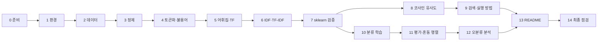

# A4-1 단계별 실습 가이드 — TF-IDF 문서 검색·분류기 만들기

기준 과제: [A4-1 과제 명세](../subject.md)<br>
개념 설명: [개념 정리](LEARNING_GUIDE.md)

이 문서는 환경 설정부터 제출까지 **무엇을 어떤 순서로 만들고, 다음 단계로 넘어가기 전에 무엇을 확인할지** 안내합니다. 완성 코드는 없습니다. 각 단계의 짧은 코드 조각은 API 사용법이나 함수 모양을 보여 주는 용도이며, 실제 구현은 직접 채워야 합니다.

각 단계는 **목표 / 할 일 / 힌트 / 확인 방법** 순서로 되어 있습니다. 확인 방법(체크포인트)을 통과하지 못했다면 다음 단계로 넘어가지 말고 그 단계에서 원인을 찾습니다. 뒤 단계에서 생긴 오류의 원인이 앞 단계에 있는 경우가 많습니다.

## 전체 흐름



## 0단계. 시작 전에 정할 것

**목표:** 사용할 언어(한국어/영어), 데이터셋, 파일 구조를 정합니다.

**할 일**

1. [과제 명세](../subject.md)의 4장(기능 요구 사항)과 7장(제약 사항)을 한 번 더 읽고, 요구사항 목록을 메모장에 체크리스트로 옮깁니다. 14단계의 자기 점검표와 같은 형식이면 됩니다.
2. 데이터셋을 고릅니다. 처음이라면 설치 부담이 적은 **영어 20 Newsgroups(3~5개 카테고리)** 가 가장 쉽고, 한국어를 원하면 **NSMC**를 씁니다.
3. 파일 구조를 정합니다. 과제가 파일 이름을 정해 주지는 않으므로 아래는 **권장** 구조입니다. 실행 방법을 안 A(CLI)로 하려면 `main.py`가 필요합니다.

```text
A4-1/
├── README.md            # 분석 리포트 (필수 3단 구성 + 실행 방법)
├── requirements.txt     # 필수
├── main.py              # 안 A: python main.py --query "..." --topk 5
├── preprocess.py        # 정제, 토큰화, 불용어
├── tfidf.py             # NumPy TF-IDF 직접 구현
├── verify_tfidf.py      # sklearn 비교 검증
├── search.py            # 코사인 유사도, 상위 k 검색
├── classify.py          # 분류 학습/평가, 혼동 행렬 저장
├── stopwords_ko.txt     # (한국어일 때) 직접 만든 불용어 목록
└── outputs/             # 검증 로그, 혼동 행렬 PNG, 오분류 목록
```

노트북(`.ipynb`)으로 실험해도 되지만, 최종 제출물에서는 재사용할 함수를 `.py` 파일로 빼 두면 README의 실행 방법을 쓰기 쉽습니다(권장).

**확인 방법:** 데이터셋이 과제의 데이터 준비 체크리스트(500개 이상, 2개 이상 카테고리, Train/Test 분리 가능, 결측치 제거, 개인정보 미포함, 라이선스 확인)를 만족할 수 있는지 설명할 수 있습니다.

---

## 1단계. 개발 환경 만들기

**목표:** Python 3.10 이상 가상환경과 `requirements.txt`를 준비합니다.

**할 일**

```bash
python3 --version                 # 3.10 이상인지 확인
python3 -m venv .venv
source .venv/bin/activate         # Windows: .venv\Scripts\activate
pip install numpy pandas matplotlib scikit-learn nltk   # 영어
pip install konlpy                                       # 한국어일 때 추가
pip freeze > requirements.txt
```

**힌트**

- 허용 라이브러리는 Pandas, NumPy, Matplotlib/Seaborn, KoNLPy, NLTK, Scikit-learn뿐입니다. 다른 NLP 라이브러리(예: spaCy, gensim)는 쓰지 않습니다.
- NLTK 토크나이저와 불용어는 데이터를 따로 내려받아야 합니다. `nltk.download('punkt')`, `nltk.download('stopwords')`를 실행하고, 버전에 따라 `punkt_tab`을 요구하는 오류가 나면 그것도 내려받습니다.
- KoNLPy는 Java(JDK)가 필요합니다. `Okt()` 생성 시 JVM 관련 오류가 나면 JDK 설치와 `JAVA_HOME` 설정을 확인합니다. 해결이 어려우면 과제가 허용하는 대로 공백 토큰화로 대체하되, 그 영향을 리포트에서 분석해야 합니다.
- `pip freeze` 결과가 너무 길면 직접 쓴 패키지만 남겨도 됩니다(권장).

**확인 방법**

- `python -c "import numpy, sklearn, nltk; print('ok')"`가 오류 없이 실행됩니다.
- 한국어라면 `Okt().morphs("테스트 문장입니다")`가 리스트를 출력합니다.
- 새 가상환경에서 `pip install -r requirements.txt`가 성공합니다.

---

## 2단계. 데이터 불러오기와 점검

**목표:** 500개 이상, 2개 이상 카테고리의 문서와 레이블을 메모리에 올리고 상태를 확인합니다.

**할 일**

- 20 Newsgroups: `fetch_20newsgroups(subset='all', categories=[...])`로 3~5개 카테고리를 고릅니다.
- NSMC: GitHub 저장소의 `ratings_train.txt`를 내려받아 Pandas로 읽습니다. 파일은 **탭으로 구분**되어 있으므로 `sep='\t'`를 씁니다. 수십만 건이 부담스러우면 레이블 비율을 유지하며 일부만 샘플링합니다.
- 결측치(빈 문서)를 제거하고, 문서 수와 카테고리별 개수를 출력합니다.
- 문서 ID를 정합니다. 원본 인덱스를 그대로 써도 되지만, 결측치 제거 후 인덱스가 어떻게 바뀌는지 확인합니다.

**힌트**

- 20 Newsgroups에는 메일 헤더(보낸 사람 이메일, 이름)와 서명이 들어 있습니다. `remove=('headers', 'footers', 'quotes')` 옵션을 쓰면 개인정보와 "헤더만 보고 맞히는" 지름길을 함께 줄일 수 있습니다(권장). 사용 여부를 리포트의 데이터 윤리 부분에 적습니다.
- Hugging Face `load_dataset('nsmc')`는 `datasets` 버전에 따라 동작하지 않을 수 있습니다. 막히면 GitHub 원본 파일을 쓰는 편이 빠릅니다.
- 처음부터 수만 건으로 하지 마세요. 6단계 TF-IDF가 밀집 행렬이라 메모리가 빠르게 늘어납니다([개념 정리 6장](LEARNING_GUIDE.md#6-bag-of-words와-문서-단어-행렬)).

**확인 방법**

```text
문서 수: 2954, 카테고리: ['comp.graphics', 'rec.sport.baseball', 'sci.space']
카테고리별 개수: {0: 973, 1: 994, 2: 987}
빈 문서: 0
```

이런 형태로 **문서 수 500 이상, 카테고리 2개 이상, 빈 문서 0**이 확인되면 다음으로 넘어갑니다. 숫자는 옵션에 따라 다를 수 있습니다.

---

## 3단계. 텍스트 정제 함수

**목표:** 문서 하나(문자열)를 받아 정제된 문자열을 돌려주는 함수를 만듭니다.

**할 일**

```python
def clean_text(text: str) -> str:
    # TODO: 소문자 변환, URL/이메일 제거, 남길 문자 범위 외 제거, 공백 정리
    pass
```

- 남길 문자의 범위를 정규식 문자 클래스로 정의합니다. (영어 예: `[^a-z0-9\s]`, 한국어 예: `[^가-힣0-9\s]`)
- 숫자를 남길지, `ㅋㅋ`/`ㅠㅠ` 같은 자모를 남길지 결정합니다.
- **결정한 기준과 이유를 메모**합니다. README "구현 요약"에 그대로 쓰입니다.

**힌트**

- 원문과 정제 결과를 나란히 5개 정도 출력해 눈으로 확인하는 것이 가장 빠른 테스트입니다.
- 이 함수는 나중에 **검색 쿼리에도 똑같이** 적용됩니다. 문서 전용 처리를 넣지 않도록 주의합니다.
- 개념은 [개념 정리 3장](LEARNING_GUIDE.md#3-텍스트-정제)을 봅니다.

**확인 방법**

- `clean_text("Hello, World!!! Visit http://x.com")`처럼 직접 만든 입력이 의도대로 바뀝니다.
- 정제 후 빈 문자열이 된 문서가 있는지 셉니다. 있다면 제거할지 결정합니다.

---

## 4단계. 토큰화와 불용어 제거 파이프라인

**목표:** 정제된 문자열을 토큰 리스트로 바꾸는 파이프라인을 완성합니다.

**할 일**

```python
def tokenize(text: str) -> list[str]:
    # TODO: 형태소 분석기(KoNLPy) 또는 NLTK/공백 기반 토큰화
    pass

def preprocess(text: str) -> list[str]:
    # TODO: clean_text → tokenize → 불용어 제거 → (선택) 동의어 치환
    pass
```

- 불용어 목록을 정의합니다. 영어는 NLTK 목록에서 출발해 추가/삭제하고, 한국어는 직접 파일로 만듭니다.
- 동의어 처리 기준이 있다면 작은 사전으로 정의합니다(예: `{'핸드폰': '휴대폰'}`).
- 한 글자 토큰, 숫자만 있는 토큰을 남길지 정합니다.

**힌트**

- 한국어 `Okt`는 `morphs`, `nouns`, `pos`를 제공합니다. 품사를 보고 조사(`Josa`), 어미(`Eomi`), 구두점(`Punctuation`)을 걸러 내는 방식이 불용어 목록보다 체계적일 수 있습니다. 품사 이름은 분석기마다 다르니 실제 출력을 보고 정합니다.
- 형태소 분석은 느립니다. 전체 문서의 토큰화 결과를 한 번 만들어 `pickle`이나 JSON으로 저장해 두면 반복 실험이 빨라집니다(권장).
- 말뭉치 전체에서 가장 많이 나온 토큰 상위 30개를 출력해 보면 불용어 후보가 보입니다. "왜 이 단어를 불용어로 정했는가"의 근거로 이 표를 쓸 수 있습니다.
- 감성(긍정/부정) 데이터라면 `not`, `안`, `못` 같은 부정 표현을 불용어로 지우지 않는 것이 좋습니다.

**확인 방법**

- 문서 3개의 `원문 → 정제 → 토큰` 결과를 출력해 의도대로인지 봅니다.
- 상위 빈도 토큰 목록에 조사, 관사, 구두점이 남아 있지 않습니다.
- 공백 토큰화를 대안으로 쓴다면, 같은 문서의 형태소 토큰화 결과와 비교할 수 있도록 두 결과를 모두 기록해 둡니다(리포트에서 "성능이 왜 달라지는지" 분석에 필요).

---

## 5단계. 어휘집과 TF 행렬

**목표:** 토큰 리스트들로부터 어휘집과 `(N, V)` TF 행렬을 NumPy로 만듭니다.

**할 일**

```python
def build_vocab(tokenized_docs: list[list[str]]) -> dict[str, int]:
    # TODO: 모든 토큰을 모아 정렬한 뒤 {토큰: 열 번호}
    pass

def compute_tf(tokenized_docs, vocab) -> np.ndarray:
    # TODO: shape (N, V), 원소 = 문서 i에서 토큰 j의 출현 횟수
    pass
```

**힌트**

- 어휘집을 **정렬된 순서**로 만들면 scikit-learn과 열 순서가 자연스럽게 맞습니다.
- 한 문서의 토큰을 열 번호 리스트로 바꾼 뒤 `np.bincount(idx, minlength=V)`를 쓰면 반복문 안에서 단어를 하나씩 세지 않아도 됩니다.
- 먼저 [개념 정리 6장의 3문서 예제](LEARNING_GUIDE.md#6-bag-of-words와-문서-단어-행렬)로 실행해 손 계산 표와 비교합니다.

**확인 방법**

- 예제 3문서에서 TF 행렬이 `[[0,1,1,0],[1,0,1,0],[0,2,0,1]]`입니다.
- 실제 데이터에서 `tf.shape == (문서 수, 어휘 수)`이고, `tf.sum(axis=1)`이 각 문서의 토큰 수와 같습니다.

---

## 6단계. IDF, TF-IDF, 정규화

**목표:** NumPy만으로 TF-IDF 행렬을 계산하는 함수를 완성합니다.

**할 일**

```python
def compute_tfidf(tf: np.ndarray, smooth_idf=True, sublinear_tf=False, norm="l2"):
    # TODO: 1) df  2) idf  3) (선택) sublinear tf  4) tf * idf  5) 행별 L2 정규화
    # 반환: tfidf 행렬, idf 벡터 (쿼리 변환에 재사용)
    pass
```

**힌트**

- df는 횟수가 아니라 **나온 문서 수**입니다. 불리언 마스크를 열 방향으로 더합니다.
- scikit-learn과 맞추려면 **자연로그**와 `+1`이 들어간 식을 써야 합니다. 식은 [개념 정리 8.2](LEARNING_GUIDE.md#82-idf-inverse-document-frequency-역문서-빈도)의 표를 봅니다.
- `sublinear_tf=True`일 때 `np.log(0)`은 `-inf`가 됩니다. tf가 0인 칸은 그대로 0으로 두어야 합니다.
- 행별로 나눌 때 `keepdims=True`로 `(N, 1)` 모양을 유지하고, 길이가 0인 행(토큰이 하나도 없는 문서)은 0으로 나누지 않게 처리합니다.
- **IDF 벡터를 함께 반환**해야 8단계에서 쿼리를 같은 기준으로 변환할 수 있습니다.

**확인 방법**

- 예제 3문서에서 IDF가 `[1.6931, 1.2877, 1.2877, 1.6931]`, 정규화 후 D3 행이 `[0, 0.8356, 0, 0.5494]`입니다.
- 실제 데이터에서 `np.linalg.norm(tfidf, axis=1)`이 (빈 문서를 제외하고) 모두 1.0입니다.
- 결과에 `nan`이나 `inf`가 없습니다(`np.isfinite(tfidf).all()`).

---

## 7단계. scikit-learn 검증 로그

**목표:** 직접 구현과 `TfidfVectorizer`의 최대 오차가 1e-6 이내임을 보이고, 그 로그를 저장합니다.

**할 일**

- 같은 토큰 리스트를 `TfidfVectorizer`에 넣습니다. 내부 토큰화를 끄는 방법은 [개념 정리 9.2](LEARNING_GUIDE.md#92-같은-토큰)를 봅니다.
- `smooth_idf`, `sublinear_tf`, `norm`을 직접 구현에 준 값과 **똑같이** 지정합니다.
- shape, 최대 오차, 평균 오차, PASS/FAIL을 출력하고 파일(`outputs/verify_log.txt` 등)로도 남깁니다.

**힌트**

- sklearn 결과는 희소 행렬이므로 `.toarray()`가 필요합니다.
- 어휘집 크기가 다르면 값 비교 전에 **shape부터** 다릅니다. 이때는 토큰 차이부터 찾습니다. `set(내_어휘) ^ set(sklearn_어휘)`로 차이 나는 토큰을 출력해 보세요.
- shape는 같은데 오차가 크면 열 순서, IDF 식, 정규화 순서를 차례로 의심합니다.
- 기본 설정 외에 한두 가지 설정 조합으로도 검증하면 구현 신뢰도가 높아집니다(권장).

**확인 방법**

과제 결과 예시와 비슷한 형태의 로그가 나오고, **사용한 sklearn 설정이 로그에 적혀 있습니다.**

```text
=== TF-IDF 구현 검증 결과 ===
TF-IDF 행렬 shape: (N, V)
  - sklearn 설정: smooth_idf=?, sublinear_tf=?, norm=?
  - 최대 오차: ...
  - 결과: PASS (허용 오차 1e-6 이내)
```

---

## 8단계. 쿼리 벡터화와 코사인 유사도

**목표:** 쿼리 문자열을 TF-IDF 벡터로 바꾸고, 모든 문서와의 코사인 유사도를 NumPy로 계산합니다.

**할 일**

```python
def vectorize_query(query: str, vocab, idf) -> np.ndarray:
    # TODO: preprocess → 어휘집에 있는 토큰만 tf → × idf → L2 정규화
    pass

def cosine_similarity(doc_matrix: np.ndarray, q: np.ndarray) -> np.ndarray:
    # TODO: (q · 문서) / (||q|| × ||문서||), 0으로 나누기 방지
    pass
```

**힌트**

- 쿼리도 3~4단계의 **같은 `preprocess`** 를 씁니다.
- 어휘집에 없는 토큰은 버립니다. 모든 토큰이 없으면 영벡터가 됩니다.
- `sklearn.metrics.pairwise.cosine_similarity`는 쓰지 않습니다. 제약 사항이 "NumPy 벡터 연산으로 직접 구현"입니다. 대신 **검증용으로** 결과를 한 번 비교해 보는 것은 괜찮습니다(권장).
- 과제 결과 예시처럼 "내적 / (노름 × 노름) = 값" 계산 과정을 한 쿼리에 대해 출력해 두면 README에 쓰기 좋습니다.

**확인 방법**

- 예제 말뭉치에서 쿼리 `"고양이 밥"`의 유사도가 `[0.4280, 0, 0.9431]`입니다([개념 정리 10장](LEARNING_GUIDE.md#10-벡터-내적-노름-코사인-유사도)).
- 문서 하나의 원문을 그대로 쿼리로 넣으면 그 문서가 1위(유사도 1.0에 가까움)로 나옵니다.
- 모든 유사도가 0 이상 1 이하입니다.

---

## 9단계. 검색 기능과 실행 방법

**목표:** 상위 5개 문서를 `(점수, 문서 ID, 텍스트 스니펫)`으로 돌려주는 검색 기능을 만들고, README에 쓸 실행 방법(안 A 또는 안 B)을 정합니다.

**할 일**

- 안 B 함수 시그니처를 기준으로 만듭니다. 안 A를 택해도 내부에서 이 함수를 부르면 됩니다.

```python
def search(query: str, topk: int = 5) -> list[tuple[float, int, str]]:
    # TODO: vectorize_query → cosine_similarity → 상위 topk 인덱스 → (점수, ID, 스니펫)
    pass
```

- 안 A를 택하면 `main.py`에서 `argparse`로 `--query`와 `--topk`를 받습니다.

```python
parser.add_argument("--query", required=True)
parser.add_argument("--topk", type=int, default=5)
```

**힌트**

- `np.argsort`는 오름차순입니다. 내림차순으로 뒤집는 것을 잊지 마세요.
- 스니펫은 원문(정제 전)의 앞부분 수십 자에서 줄바꿈을 공백으로 바꾼 것이 읽기 좋습니다.
- 실행할 때마다 전체 말뭉치를 다시 토큰화하면 느립니다. 4단계에서 저장한 토큰 결과나 계산한 행렬을 불러오게 하면 좋습니다(권장).
- 쿼리 단어가 모두 어휘집에 없을 때 오류 대신 안내 메시지를 내는지 확인합니다.

**확인 방법**

- `python main.py --query "..." --topk 5`(안 A) 또는 `search("...")`(안 B)가 5개 결과를 점수 내림차순으로 출력합니다.
- 서로 다른 주제의 쿼리 3개 이상을 넣었을 때, 상위 결과가 대체로 그 주제의 카테고리 문서입니다.
- 이 출력 예시를 README에 붙일 수 있도록 저장합니다.

---

## 10단계. 분류 모델 학습

**목표:** 직접 구현한 TF-IDF를 특성으로 Logistic Regression 또는 Linear SVM 중 하나를 학습합니다.

**할 일**

- `train_test_split`으로 **8:2**, **`random_state` 고정**으로 나눕니다.
- 학습 데이터로 어휘집과 IDF를 만들고, 테스트 데이터는 그 어휘집/IDF로 변환합니다(권장, [개념 정리 11장 데이터 누수](LEARNING_GUIDE.md#데이터-누수-권장-주의사항)).
- `LogisticRegression` 또는 `LinearSVC` 중 하나를 학습합니다.

**힌트**

- `stratify=y`를 주면 카테고리 비율이 학습/테스트에 고르게 나뉩니다(권장).
- 테스트 문서를 변환하는 함수는 사실상 8단계 `vectorize_query`와 같은 일을 합니다. 재사용할 수 있게 설계해 보세요.
- `ConvergenceWarning`이 나오면 `max_iter`를 늘립니다.
- 나눈 결과의 개수(`Train 몇 / Test 몇`)를 출력해 둡니다. 결과 예시에도 들어가는 항목입니다.

**확인 방법**

- 학습/테스트 개수 비율이 대략 8:2입니다.
- 같은 코드를 두 번 실행했을 때 결과 숫자가 똑같습니다(재현성).
- 학습 데이터 정확도가 테스트보다 지나치게 높지 않은지 봅니다. 크게 다르면 과적합 여부를 리포트에 적습니다.

---

## 11단계. 성능 평가와 혼동 행렬

**목표:** 정확도, F1-Score를 측정하고 혼동 행렬을 시각화해 이미지로 저장합니다.

**할 일**

- `accuracy_score`, `f1_score`로 지표를 계산합니다. F1의 `average`(macro/weighted)를 정하고 리포트에 명시합니다.
- `confusion_matrix`와 `ConfusionMatrixDisplay`(또는 Seaborn `heatmap`)로 그림을 그려 `outputs/confusion_matrix.png`처럼 저장합니다.
- `classification_report`로 카테고리별 정밀도/재현율도 함께 출력합니다(권장).

**힌트**

- 혼동 행렬의 축 라벨을 숫자 대신 카테고리 이름으로 붙입니다.
- 지표 해석은 [개념 정리 12장](LEARNING_GUIDE.md#12-평가지표-정확도-정밀도-재현율-f1-혼동-행렬)의 손 계산 예제를 참고합니다.
- `plt.savefig`는 `plt.show()`보다 먼저 호출해야 빈 그림이 저장되지 않습니다.

**확인 방법**

- 출력된 정확도가 혼동 행렬의 대각선 합 / 전체 합과 같습니다(손으로 한 번 검산).
- PNG 파일이 열리고, 어느 카테고리끼리 자주 헷갈리는지 한 문장으로 말할 수 있습니다.

---

## 12단계. 오분류 분석

**목표:** 오분류된 문서 5개 이상을 골라 원인을 BoW 한계와 연결해 분석합니다.

**할 일**

- 테스트에서 `y_pred != y_test`인 문서를 모읍니다.
- 각 문서에 대해 원문 일부, 실제 레이블, 예측 레이블, 그 문서에서 TF-IDF 값이 큰 단어 상위 몇 개를 출력합니다.
- 원인을 유형으로 분류합니다: 어순 무시, 동음이의어, 동의어 불일치, 부정/문맥, OOV, 짧은 문서(희소성) 등.

**힌트**

- 로지스틱 회귀라면 `model.coef_`에서 그 단어들이 어느 카테고리에 큰 가중치를 갖는지 확인하면 "왜 그렇게 예측했는지" 근거가 생깁니다.
- 과제 결과 예시의 `예측 / 실제 / 문서 / 원인 / 한계` 형식을 참고합니다.
- BoW 한계 분석에는 실제 오분류 외에도 "같은 TF-IDF 벡터가 나오는 두 문장"처럼 **직접 만든 예시**를 함께 실행해 보이면 설득력이 있습니다.
- 개념은 [개념 정리 13장](LEARNING_GUIDE.md#13-bow의-한계와-오분류-분석)을 봅니다.

**확인 방법**

- 오분류 사례가 5개 이상이고, 사례마다 "어떤 단어가 어떻게 오해를 일으켰는가"와 "그것이 BoW의 어떤 한계인가"가 둘 다 적혀 있습니다.

---

## 13단계. README 작성

**목표:** 필수 3단 구성과 실행 방법을 갖춘 분석 리포트를 씁니다.

**할 일:** 아래 목차를 채웁니다. 1~3번 제목은 과제가 정한 3단 구성입니다.

| README 부분 | 반드시 들어갈 내용 (과제 기준) |
| --- | --- |
| 실행 방법 | 안 A(CLI 커맨드 + 예시 출력) 또는 안 B(`search` 함수 시그니처) 중 하나 이상, `requirements.txt` 설치 방법 |
| 1. 구현 요약 | 전처리 파이프라인(정제 범위, 토큰화 방식, 불용어/동의어 기준과 근거), TF-IDF 수식과 구현 과정, 검색/분류 시스템 |
| 2. 검증/실험 결과 | TF-IDF 검증 로그(사용한 sklearn 설정 포함), 분류 성능 지표(정확도, F1), 혼동 행렬 |
| 3. 한계와 개선 방향 | BoW 한계 분석, 오분류 원인(5건 이상), 후속 학습 방향 |

**힌트**

- 데이터셋 출처, 사용한 카테고리, 문서 수, 라이선스/개인정보 확인 내용을 "구현 요약" 앞이나 안에 짧게 적습니다(데이터 준비 체크리스트 대응).
- 공백 토큰화로 대체했다면 "성능이 왜 달라지는지" 분석을 3번 부분에 반드시 넣습니다.
- 수식은 `$...$`로 쓰면 GitHub에서 렌더링됩니다.
- 출력 결과는 직접 실행한 실제 값을 붙입니다. 과제 결과 예시의 숫자를 그대로 쓰지 않습니다.

**확인 방법:** README만 읽은 사람이 설치 → 실행 → 결과 해석까지 따라 할 수 있습니다. 새 가상환경에서 README대로 실행해 봅니다.

---

## 14단계. 제출 전 최종 점검

| 과제 요구사항 ([subject.md](../subject.md)) | 어디서 확인하는지 |
| --- | --- |
| 문서 500개 이상 | 2단계 출력, README 데이터 설명 |
| 카테고리 2개 이상 | 2단계 카테고리별 개수 |
| 결측치 제거, 개인정보 미포함, 라이선스 확인 | 2단계 처리 코드, README 데이터 설명 |
| 텍스트 정제(특수문자 제거, 소문자 등) | `clean_text`, README 구현 요약 |
| 토큰화 (한국어 형태소 권장 / 영어 NLTK·공백) | `tokenize`, 4단계 출력 |
| 공백 토큰화 대체 시 성능 차이 분석 | README 한계 부분 (해당 시) |
| 불용어 목록 정의·제거 | 불용어 파일/목록, `preprocess` |
| 전처리 기준(특수문자 범위, 불용어/동의어) 설계 근거 | README 구현 요약 |
| NumPy로 TF-IDF 행렬 계산 함수 | `compute_tf`, `compute_tfidf` |
| TF를 행렬로, IDF를 로그 역수로 | 5·6단계 체크포인트 |
| sklearn과 오차 1e-6 이내 검증 | 7단계 로그 파일 |
| 검증에 쓴 sklearn 설정(sublinear_tf, smooth_idf, norm 등) README 명시 | README 검증 결과 |
| 쿼리를 TF-IDF 벡터로 변환 | `vectorize_query` |
| 코사인 유사도를 NumPy로 직접 계산 | `cosine_similarity` (sklearn 함수 미사용) |
| 상위 5개 결과에 점수, 문서 ID, 스니펫 포함 | 9단계 출력 |
| TF-IDF 특성으로 분류 모델 학습 | 10단계 코드 (직접 구현 TF-IDF 사용) |
| LogReg 또는 Linear SVM, 8:2, random_state 고정 | 10단계 코드 |
| 정확도, F1 측정 | 11단계 출력, README |
| 혼동 행렬 시각화 | PNG 파일, README에 삽입 |
| 오분류 5개 이상 원인 분석 (BoW 한계와 연결) | 12단계 결과, README 한계 부분 |
| README 필수 3단 구성 | README 목차 |
| 실행 방법 (안 A 또는 안 B) | README 실행 방법 |
| `requirements.txt` 제출 | 저장소 루트 |
| 허용 라이브러리만 사용 | `requirements.txt`, import 문 |
| TF-IDF 핵심 로직에 sklearn 미사용 | `tfidf.py`에 sklearn import 없음 |
| Python 3.10 이상 | 1단계 버전 확인 |

---

## 자주 하는 실수

| 증상 | 원인 | 해결 |
| --- | --- | --- |
| sklearn과 shape가 다름 | sklearn이 내부 토큰화/소문자화를 함 | `analyzer` 또는 `tokenizer` + `lowercase=False` + `token_pattern=None`으로 같은 토큰 사용 |
| shape는 같은데 오차가 0.1 이상 | 열 순서가 다름 | 어휘집을 정렬하거나 `vocabulary=` 지정 |
| 오차가 일정한 비율로 어긋남 | 로그 밑, smooth 식, `+1` 누락 | 자연로그와 sklearn IDF 식 확인 |
| `RuntimeWarning: divide by zero` | 빈 문서나 OOV 쿼리의 노름이 0 | 노름이 0인 행은 나누지 않음 |
| `sublinear_tf`에서 `-inf` | `log(0)` | tf > 0인 칸에만 로그 적용 |
| 메모리 부족 | 문서·어휘가 너무 많은 밀집 행렬 | 카테고리 축소, 문서 샘플링 |
| 검색 결과가 엉뚱함 | 쿼리에 다른 전처리 적용 | 문서와 같은 `preprocess` 재사용 |
| 실행할 때마다 정확도가 바뀜 | `random_state` 미고정 | 분할(필요시 모델)에도 고정값 지정 |
| 분류 성능이 비현실적으로 높음 | 20 Newsgroups 헤더에 정답 단서 | `remove=('headers', 'footers', 'quotes')` 검토 |

---

## 보너스 과제 (선택)

필수 요구사항을 모두 끝낸 뒤에 합니다. 개념은 [개념 정리 14장](LEARNING_GUIDE.md#14-보너스-tf-변형-bm25-역색인)을 봅니다.

### 1. 다양한 TF 변형

- 힌트: `compute_tfidf`에 `tf_mode` 같은 인자를 추가해 Raw Count, Log Normalization, Double Normalization을 바꿔 끼울 수 있게 하면 나머지 코드를 그대로 재사용할 수 있습니다.
- 힌트: Double Normalization은 **문서마다** 최대 tf로 나눕니다. `axis=1`, `keepdims=True`를 떠올리세요.
- 확인: 같은 분할·같은 모델에서 방식별 정확도/F1, 같은 쿼리 세트에서 검색 결과 차이를 표로 비교합니다.

### 2. BM25

- 힌트: BM25는 쿼리 단어에 대해서만 합산합니다. 문서 길이 벡터 `(N,)`와 평균 길이를 먼저 구해 두면 분모를 브로드캐스팅으로 한 번에 계산할 수 있습니다.
- 힌트: $k_1$, $b$ 값과 사용한 IDF 식을 README에 적습니다.
- 확인: 같은 쿼리에서 TF-IDF와 BM25의 상위 5개를 나란히 놓고, 순위가 달라진 문서가 왜 달라졌는지(길이, 반복 단어) 설명합니다.

### 3. 역색인

- 힌트: `dict[str, list[int]]`로 시작합니다. 쿼리 단어의 문서 목록을 합집합으로 모아 그 문서들만 점수를 계산합니다.
- 힌트: 전체 스캔과 결과(상위 5개)가 같은지 먼저 확인한 뒤 속도를 비교합니다.
- 확인: 이론적 시간 복잡도와 `time.perf_counter`로 잰 실제 시간을 표로 비교합니다.
